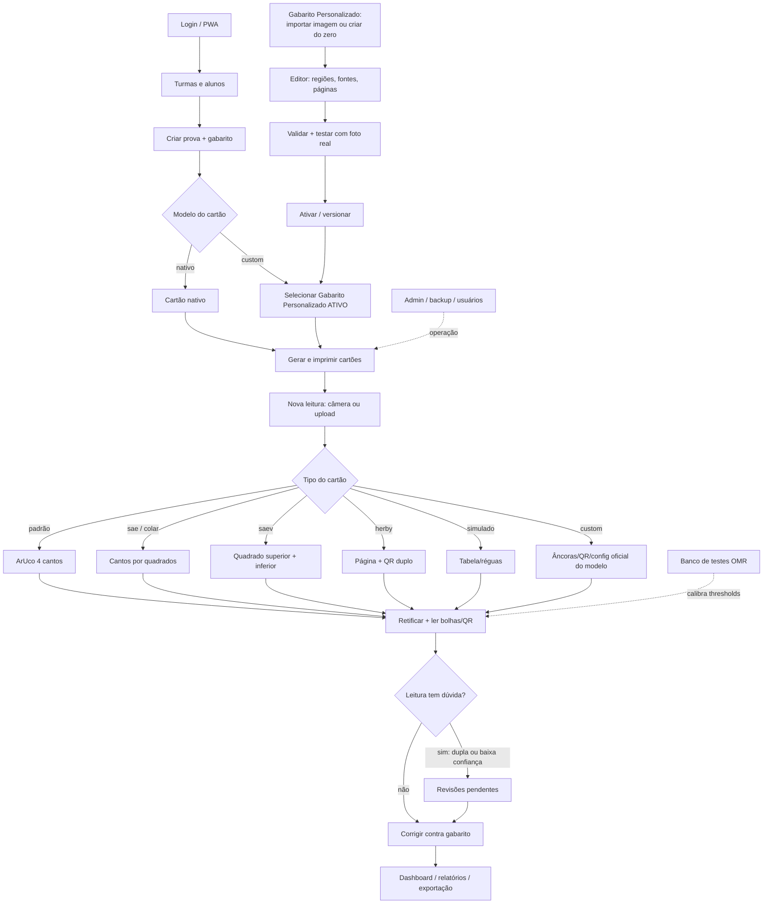
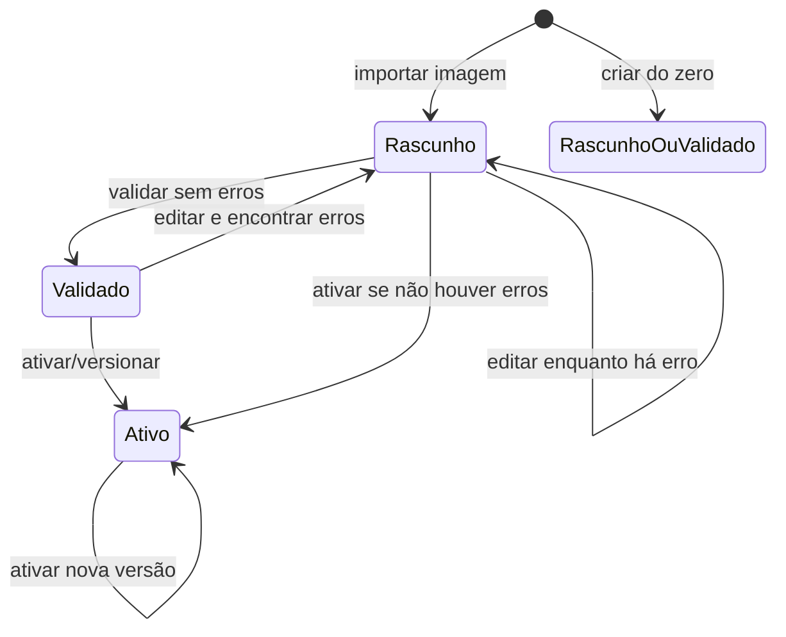

# Fluxo do sistema OMR — revisado

Este documento é a fonte única do fluxo funcional e das regras de negócio do
sistema. Ele substitui o fluxo genérico que existia apenas na tela de Ajuda.

## 1. Fluxo macro

Regra importante sobre prova com Gabarito Personalizado:

- No frontend, a prova grava `templateType: 'padrao'` + `customTemplateId`.
- No backend, a avaliação vira `template: 'custom'`.
- Somente modelo com `status = 'ativo'` e sem alterações pendentes pode ser
  vinculado a uma prova nova.

## 2. Modelos de cartão

| Modelo | Regra |
|---|---|
| `padrão` | Layout clássico A4, ArUco 4 cantos, dual ou single |
| `sae` | Cabeçalho SAE próprio, cantos detectados por quadrados |
| `colar` | Mesma geometria do SAE, sem cabeçalho/QR |
| `saev` | Dual obrigatório, 16..26 questões por disciplina |
| `herby` | 1..26 questões, permite layout duplo ou único |
| `simulado` | Tabela única, 22 questões fixas |
| `custom` | Modelo importado ou gerado, regiões normalizadas |

## 3. Ciclo do Gabarito Personalizado

Regras oficiais:

- `rascunho`: modelo em preparação, não pode vincular prova nova.
- `validado`: configuração consistente, mas ainda não é o cartão oficial.
- `ativo`: existe snapshot imutável em `CustomTemplateVersion`; vinculação com
  prova liberada.
- Leitura e impressão oficiais usam o snapshot da versão ativa.
- Enquanto o editor tiver alterações não ativadas, a API devolve
  `pending_version = true` e a UI avisa antes de gerar arquivo.

## 4. Leitura e correção

1. Usuário escolhe a prova e envia foto/arquivo.
2. Backend decodifica a imagem e escolhe o leitor pelo tipo do cartão.
3. Backend retifica, lê bolhas, QR, matrícula e classifica:
   - marcada;
   - em branco;
   - dupla marcação;
   - baixa confiança.
4. Leituras com dupla marcação ou baixa confiança entram na fila de revisão.
5. Depois da revisão confirmação/correção, resultado entra em dashboard e
   relatórios.

Regras de UX do leitor:

- No mobile, a câmera fica em destaque; moldura, alvos das âncoras, captura
  manual/automática e fallback para galeria têm prioridade.
- No desktop, a tela organiza seleção da prova, configurações avançadas, fila
  de cartões e resultado do processamento.
- A lógica de detecção, QR, classificação e correção continua exclusiva do
  backend.

## 6. Regras operacionais

- Backup/restore e usuários ficam na área admin.
- Exclusão de prova cria lápide por 30 dias para não ressuscitar em outro
  aparelho.
- Banco de testes OMR usa os mesmos leitores de produção para calibrar
  thresholds.
- Fontes do editor de criação usam `pt`; a conversão para px depende do DPI do
  cartão.
- A prévia do gerador de cartão (`/api/custom-templates/generate-preview`) não
  grava nada, mas exige sessão porque usa o mesmo desenhista oficial.
- Impressão por lista manual gera códigos temporários e não substitui o lote
  oficial vinculado à prova.

## 5. Ciclo de vida da avaliação (reestruturação)

A **avaliação** é o núcleo do sistema: liga prova, turmas, alunos, cartões,
leituras e resultados. A **prova** guarda apenas a estrutura reutilizável
(questões, disciplinas, layout, escala de nota) e pode servir N avaliações sem
duplicar participantes nem identificadores.

### 5.1 Modelo

| Tabela | Papel |
|---|---|
| `provas` | estrutura reutilizável (`avaliacoes.prova_id`) |
| `avaliacoes` | aplicação da prova: status, ano letivo, publicação |
| `avaliacao_turmas` | junção N:N (avaliação atende 1..N turmas) |
| `gabarito_versoes` | histórico do gabarito oficial (versão ativa) |
| `leituras` | cada leitura de cartão, com `parent_id` no reprocessamento |
| `revisoes_manuais` | auditoria de cada resposta corrigida à mão |
| `auditoria` | log append-only das operações importantes |

O backfill (`database._backfill_provas`) cria uma `provas` para cada avaliação
antiga — `external_id`, alunos, gabaritos e QR permanecem intactos.

### 5.2 Estados e etapas

Estados (ordem do fluxo): `rascunho → em_preparacao → pronta_impressao →
impressa → em_aplicacao → aguardando_correcao → em_correcao →
aguardando_revisao → corrigida → publicados → arquivada`.

Etapas visuais (6): Preparação → Impressão → Aplicação → Leitura → Revisão →
Resultados. Cada uma tem status próprio e ação contextual; a regra vive em
`workflow/status.py` no backend e é espelhada em `src/utils/workflow.ts`.

- O status derivado sai dos dados (cartões gerados/recebidos/corrigidos e
  revisões pendentes); o registrado cobre o que os dados não provam (impressa,
  em aplicação, arquivada).
- Transição manual só avança (`PATCH /api/avaliacoes/{id}/status`) e fica
  registrada na auditoria.
- Publicar exige zero leituras pendentes e ao menos um cartão corrigido.

### 5.3 Identidade e integridade

- Cada cartão tem QR/`codigo_unico` único ligado a aluno, avaliação e prova; o
  nome do aluno nunca é identificador.
- Uma leitura nunca gera resultado duplicado: reenviar o mesmo cartão atualiza
  o mesmo `gabaritos_nomeados` e cria uma NOVA `leituras` com `parent_id`.
- Reaproveitar prova/modelo em avaliação nova é explícito; participantes,
  cartões e resultados das avaliações anteriores nunca se misturam.
- Editar o catálogo de turmas não altera alunos já materializados nas provas
  (a materialização é cópia).

### 5.4 Edição e situação do aluno (catálogo de turmas)

- Endpoint: `PATCH /api/turmas/{turma_id}/alunos/{aluno_id}` — mesmo caminho do
  DELETE, porque o aluno vive no catálogo da turma.
- Campos: `nome` (obrigatório; vazio → 400), `matricula` e
  `identificador_externo` (string vazia limpa o campo) e `nova_turma_id`
  (opcional, move o aluno; só aceita turma visível ao usuário).
- Matrícula não pode repetir dentro da turma de destino: outra pessoa já usando
  ela → 400. A matrícula do próprio aluno nunca é conflito.
- A materialização é cópia: editar o catálogo **não** altera alunos já
  importados em provas, nem cartões/QR emitidos. O nome impresso permanece o da
  época da geração.
- Situação do aluno no catálogo: `ativo`, `inativo` ou `transferido`
  (`PATCH /api/turmas/{id}/alunos/{alunoId}/situacao`). A tela **Alunos**
  mostra a situação e o histórico do aluno em avaliações (notas por avaliação).
- Turmas têm ano letivo e arquivamento (`PATCH /api/turmas/{id}`); arquivadas
  somem da listagem padrão e voltam com `?arquivadas=all`.

- Endpoint: `PATCH /api/turmas/{turma_id}/alunos/{aluno_id}` — mesmo caminho do
  DELETE, porque o aluno vive no catálogo da turma.
- Campos: `nome` (obrigatório; vazio → 400), `matricula` e
  `identificador_externo` (string vazia limpa o campo) e `nova_turma_id`
  (opcional, move o aluno; só aceita turma visível ao usuário).
- Matrícula não pode repetir dentro da turma de destino: outra pessoa já usando
  ela → 400. A matrícula do próprio aluno nunca é conflito.
- A materialização é cópia: editar o catálogo **não** altera alunos já
  importados em provas, nem cartões/QR emitidos. O nome impresso permanece o da
  época da geração.
- Tela **Alunos**: ação "Editar" na linha da tabela (e no card do mobile) e
  "Editar aluno" no painel de detalhes. O formulário avisa sobre matrícula já
  usada antes de enviar e mostra o erro do backend quando ele ocorre.
