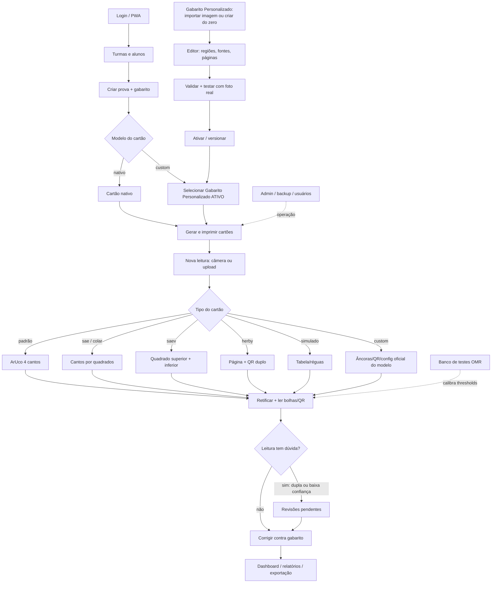
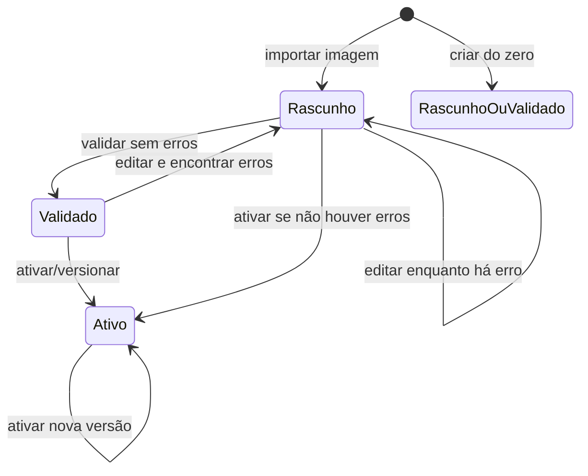

# Fluxo do sistema OMR — revisado

Este documento é a fonte única do fluxo funcional e das regras de negócio do
sistema. Ele substitui o fluxo genérico que existia apenas na tela de Ajuda.

## 1. Fluxo macro

Regra importante sobre prova com Gabarito Personalizado:

- No frontend, a prova grava `templateType: 'padrao'` + `customTemplateId`.
- No backend, a avaliação vira `template: 'custom'`.
- Somente modelo com `status = 'ativo'` e sem alterações pendentes pode ser
  vinculado a uma prova nova.

## 2. Modelos de cartão

| Modelo | Regra |
|---|---|
| `padrão` | Layout clássico A4, ArUco 4 cantos, dual ou single |
| `sae` | Cabeçalho SAE próprio, cantos detectados por quadrados |
| `colar` | Mesma geometria do SAE, sem cabeçalho/QR |
| `saev` | Dual obrigatório, 16..26 questões por disciplina |
| `herby` | 1..26 questões, permite layout duplo ou único |
| `simulado` | Tabela única, 22 questões fixas |
| `custom` | Modelo importado ou gerado, regiões normalizadas |

## 3. Ciclo do Gabarito Personalizado

Regras oficiais:

- `rascunho`: modelo em preparação, não pode vincular prova nova.
- `validado`: configuração consistente, mas ainda não é o cartão oficial.
- `ativo`: existe snapshot imutável em `CustomTemplateVersion`; vinculação com
  prova liberada.
- Leitura e impressão oficiais usam o snapshot da versão ativa.
- Enquanto o editor tiver alterações não ativadas, a API devolve
  `pending_version = true` e a UI avisa antes de gerar arquivo.

## 4. Leitura e correção

1. Usuário escolhe a prova e envia foto/arquivo.
2. Backend decodifica a imagem e escolhe o leitor pelo tipo do cartão.
3. Backend retifica, lê bolhas, QR, matrícula e classifica:
   - marcada;
   - em branco;
   - dupla marcação;
   - baixa confiança.
4. Leituras com dupla marcação ou baixa confiança entram na fila de revisão.
5. Depois da revisão confirmação/correção, resultado entra em dashboard e
   relatórios.

Regras de UX do leitor:

- No mobile, a câmera fica em destaque; moldura, alvos das âncoras, captura
  manual/automática e fallback para galeria têm prioridade.
- No desktop, a tela organiza seleção da prova, configurações avançadas, fila
  de cartões e resultado do processamento.
- A lógica de detecção, QR, classificação e correção continua exclusiva do
  backend.

## 5. Regras operacionais

- Backup/restore e usuários ficam na área admin.
- Exclusão de prova cria lápide por 30 dias para não ressuscitar em outro
  aparelho.
- Banco de testes OMR usa os mesmos leitores de produção para calibrar
  thresholds.
- Fontes do editor de criação usam `pt`; a conversão para px depende do DPI do
  cartão.
- A prévia do gerador de cartão (`/api/custom-templates/generate-preview`) não
  grava nada, mas exige sessão porque usa o mesmo desenhista oficial.
- Impressão por lista manual gera códigos temporários e não substitui o lote
  oficial vinculado à prova.
